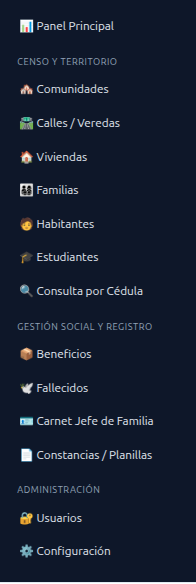
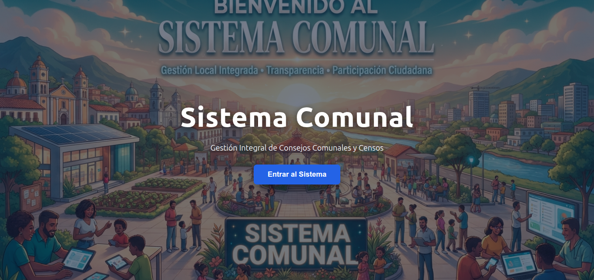
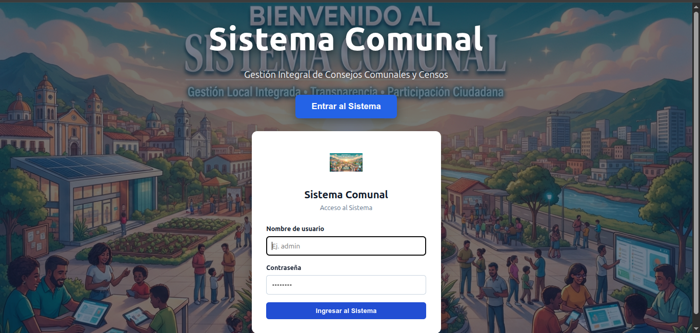
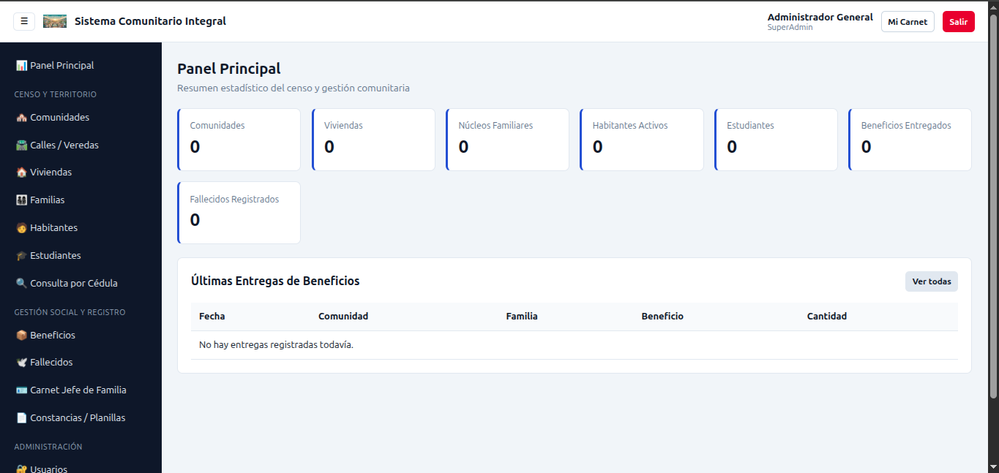
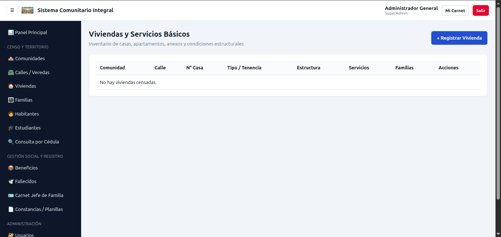
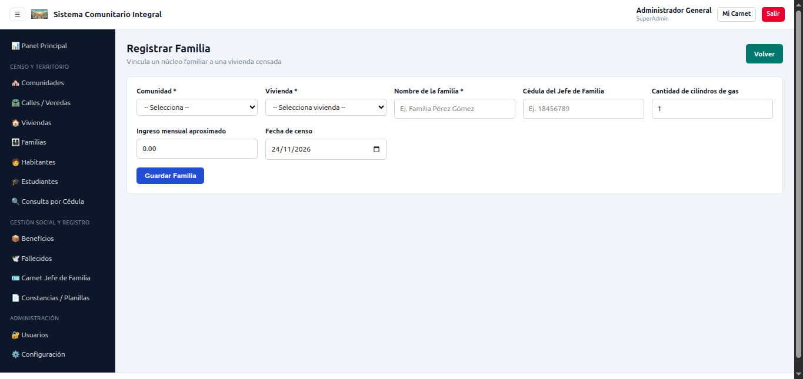
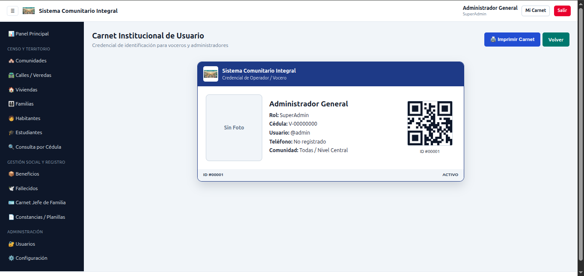
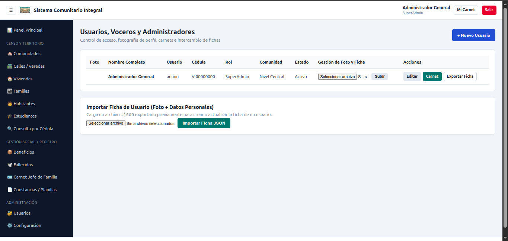

# Manual de Instalación y Uso — Sistema Comunal

**Sistema Comunitario Integral**  
*Guía rápida de instalación en entorno local (XAMPP / Linux Mint) y manual de operación por módulos.*

---

## Tabla de Contenidos

1. [Requisitos Previos](#1-requisitos-previos)
2. [Instalación del Sistema](#2-instalación-del-sistema)
   - [2.1 Ubicación de los archivos en XAMPP](#21-ubicación-de-los-archivos-en-xampp)
   - [2.2 Creación e importación de la Base de Datos](#22-creación-e-importación-de-la-base-de-datos)
   - [2.3 Configuración de la conexión](#23-configuración-de-la-conexión)
   - [2.4 Permisos de carpetas de imágenes](#24-permisos-de-carpetas-de-imágenes)
   - [2.5 Primer acceso al sistema](#25-primer-acceso-al-sistema)
3. [Guía de Uso por Módulos](#3-guía-de-uso-por-módulos)
   - [3.1 Módulos del Sistema](#31-módulos-del-sistema)
   - [3.2 Portada e Inicio de Sesión (`index.php`)](#32-portada-e-inicio-de-sesión-indexphp)
   - [3.3 Login de Acceso al Sistema (`index.php`)](#33-login-de-acceso-al-sistema-indexphp)
   - [3.4 Panel Principal (`dashboard.php`)](#34-panel-principal-dashboardphp)
   - [3.5 Comunidades, Calles y Viviendas](#35-comunidades-calles-y-viviendas)
   - [3.6 Familias y Habitantes (`modulos/habitantes/`)](#36-familias-y-habitantes-moduloshabitantes)
   - [3.7 Estudiantes, Beneficios y Fallecidos](#37-estudiantes-beneficios-y-fallecidos)
   - [3.8 Carnets de Jefe de Familia y Usuario (`carnet/`)](#38-carnets-de-jefe-de-familia-y-usuario-carnet)
   - [3.9 Usuarios y Fotografía de Perfil (`modulos/usuarios/` e `img_usuarios/`)](#39-usuarios-y-fotografía-de-perfil-modulosusuarios-e-img_usuarios)

---

## 1. Requisitos Previos

- **Sistema Operativo:** Linux Mint / Ubuntu (o Windows con XAMPP).
- **Servidor Web y Base de Datos:** XAMPP con **Apache** y **MySQL / MariaDB** activos (PHP 8.0 o superior recomendado).
- **Navegador Web:** Google Chrome, Firefox, Brave o Edge actualizado.

---

## 2. Instalación del Sistema

### 2.1 Ubicación de los archivos en XAMPP

1. Copia la carpeta completa del proyecto `sistema_comunitario` dentro del directorio raíz de XAMPP:
   - En **Linux Mint**: `/opt/lampp/htdocs/sistema_comunitario`
   - En **Windows**: `C:\xampp\htdocs\sistema_comunitario`

2. Abre el panel de control de XAMPP y asegúrate de que los servicios **Apache** y **MySQL** estén iniciados:

```bash
sudo /opt/lampp/lampp start
```

---

### 2.2 Creación e importación de la Base de Datos

1. Abre tu navegador e ingresa a **phpMyAdmin**:  
   `http://localhost/phpmyadmin`
2. Haz clic en la pestaña **SQL** (o en **Importar** si tienes el archivo `.sql`).
3. Pega o carga el script de creación de la base de datos **`sistema_comunitario_integral`** (incluye tablas, vistas `vista_consulta_ciudadano`, `vista_fallecidos_detalle` y el trigger `after_insert_fallecido`) junto con el usuario inicial `admin`.
4. Presiona **Continuar** para ejecutar la creación.

> **[ESPACIO PARA IMAGEN — Base de datos `sistema_comunitario_integral` creada en phpMyAdmin]**


---

### 2.3 Configuración de la conexión

Verifica que el archivo `config/conexion.php` tenga los parámetros locales de tu servidor MySQL:

- **Host:** `localhost`
- **Usuario BD:** `root`
- **Contraseña BD:** `""` *(vacía por defecto en XAMPP)*
- **Base de datos:** `sistema_comunitario_integral`

---

### 2.4 Permisos de carpetas de imágenes

En Linux Mint, otorga permisos de escritura a las carpetas donde se almacenan los logos, fotos de usuarios y fotografías de los habitantes para los carnets:

```bash
cd /opt/lampp/htdocs/sistema_comunitario
mkdir -p fotos uploads/sistema uploads/usuarios
sudo chmod -R 777 fotos uploads
```

---

### 2.5 Primer acceso al sistema

1. Entra en tu navegador a:  
   `http://localhost/sistema_comunitario/`
2. Haz clic en **Entrar al Sistema** e inicia sesión con las credenciales iniciales:
   - **Usuario:** `admin`
   - **Contraseña:** `admin123`

---

## 3. Guía de Uso por Módulos

### 3.1 Módulos del Sistema

Vista general de los módulos disponibles en el sistema comunitario.



---

### 3.2 Portada e Inicio de Sesión (`index.php`)

Es la pantalla principal de acceso al **Sistema Comunal**. Muestra la imagen institucional a pantalla completa y un botón para desplegar el formulario de inicio de sesión seguro.

- **Uso:** Haz clic en **Entrar al Sistema** para abrir el formulario de acceso.



---

### 3.3 Login de Acceso al Sistema (`index.php`)

Formulario de autenticación para ingresar con las credenciales asignadas a cada operador o administrador.

- **Uso:** Escribe tu usuario y contraseña y presiona **Ingresar al Sistema**.



---

### 3.4 Panel Principal (`dashboard.php`)

Muestra el resumen estadístico del censo comunitario y el menú lateral de navegación. Si ingresas como **SuperAdmin**, puedes filtrar los indicadores por comunidad o ver el consolidado general.

- **Uso:** Revisa los contadores generales y selecciona en el menú izquierdo el módulo con el que deseas trabajar.



---

### 3.5 Comunidades, Calles y Viviendas

Permite estructurar territorialmente cada Consejo Comunal antes de registrar familias:

- **Comunidades:** Registra sectores, RIF o código, parroquia, municipio y estado.
- **Calles / Veredas:** Subdivide cada comunidad y asigna su vocero o líder de calle.
- **Viviendas:** Registra casas o apartamentos, tipo de tenencia, condición estructural y servicios básicos (agua, electricidad, gas directo, internet).



---

### 3.6 Familias y Habitantes (`modulos/habitantes/`)

Gestiona los núcleos familiares y el censo individual de cada ciudadano:

- **Familias:** Agrupa a los integrantes que comparten un núcleo familiar dentro de una vivienda.
- **Registrar / Editar Habitante (`registrar_habitante.php` / `editar_habitante.php`):** Permite cargar los datos personales, parentesco, caracterización social/salud y **subir o actualizar la fotografía** (guardada en `fotos/`) para su carnet.



---

### 3.7 Estudiantes, Beneficios y Fallecidos

- **Estudiantes:** Registra el nivel educativo, grado o semestre e institución de los habitantes marcados como estudiantes.
- **Beneficios Entregados:** Controla la entrega de bolsas CLAP, cilindros de gas, kits escolares y jornadas médicas por familia.
- **Fallecidos:** Registra defunciones y desactiva automáticamente al habitante del censo activo mediante el trigger de la base de datos.


---

### 3.8 Carnets de Jefe de Familia y Usuario (`carnet/`)

Genera credenciales ampliadas listas para imprimir o guardar en PDF:

- **Carnet de Jefe de Familia (`carnet/carnet_jefe_familia.php`):** Muestra la foto del titular, datos del núcleo familiar, dirección, total de integrantes y código QR.
- **Carnet Institucional de Usuario (`carnet/carnet_usuario.php`):** Muestra la foto del operador/vocero, rol, cédula, usuario, comunidad y código QR.



---

### 3.9 Usuarios y Fotografía de Perfil (`modulos/usuarios/` e `img_usuarios/`)

Permite administrar el acceso de voceros y administradores al sistema:

- **Gestión de Usuarios (`modulos/usuarios/guardar_usuario.php`):** Crea o edita usuarios, asigna roles (`SuperAdmin`, `Administrador Comunidad`, `Vocero/Censador`), comunidad y fotografía.
- **Subir Imagen de Usuario (`img_usuarios/subir_img_usuario.php`):** Permite cambiar de forma rápida la foto de perfil almacenada en `uploads/usuarios/`.

